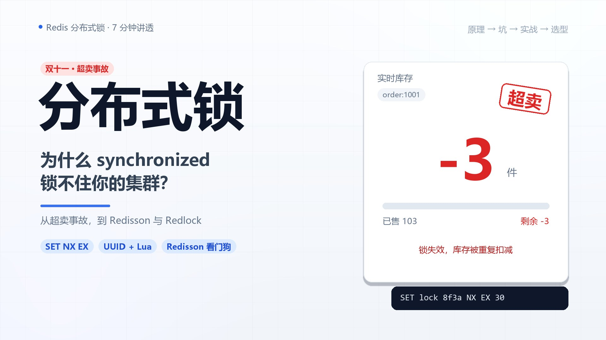

# Explainer Video Skill

用一条流水线，把主题或文稿变成带 AI 配音、逐句同步动画、中文字幕和封面的 1080P 讲解视频。



> 示例成片：**《分布式锁是什么？为什么 synchronized 锁不住你的集群？》** 6:49 / 1080P / 30fps

## 特性

- **AI 配音**：edge-tts，中文多音色、可调语速，按文本哈希缓存
- **逐句时间轴**：直接使用 TTS 的 `SentenceBoundary`，字幕与动画精确同步
- **代码化分镜**：每个场景是一个 Python 绘制函数，改文案不用重新排版
- **极简动态图形**：白底网格、圆角卡片、代码面板、印章、时间线、图标
- **一条命令出片**：Pillow 逐帧绘制 → ffmpeg/libx264 → 人声 + BGM + 响度归一化
- **封面生成**：16:9 与 16:10 两种尺寸
- **可复现**：同一文本 + 音色 = 完全相同的时长与时间轴

## 作为 Claude Code Skill 安装

```bash
git clone https://github.com/BobbyBian97/explainer-video-skill.git ~/.claude/skills/explainer-video
pip install -r ~/.claude/skills/explainer-video/requirements.txt
```

之后在 Claude Code 里提出「做一个 7 分钟的分布式锁讲解视频」之类的需求，会自动加载 `SKILL.md` 的流程。

也可以直接当普通 Python 工具用，不依赖 Claude Code。

## 快速开始

```bash
pip install -r requirements.txt

# 用示例项目跑通全流程
python engine/build.py  --project examples/distributed-lock
python engine/render.py --project examples/distributed-lock --times 20,118
python engine/render.py --project examples/distributed-lock
python engine/cover.py  --project examples/distributed-lock
```

产物在 `examples/distributed-lock/out/`。

做一个新视频：

```bash
cp -r examples/distributed-lock my-video
# 改 my-video/script.json 与 my-video/scenes.py
python engine/build.py  --project my-video
python engine/render.py --project my-video --times 5,30,60   # 抽帧检查
python engine/render.py --project my-video                  # 全片渲染 + 混音
python engine/cover.py  --project my-video
```

## 工作原理

```
script.json
   │
   ├─ edge-tts ──► 每场 mp3 + 句子边界
   │                   │
   │                   ├─ timeline.json（每句/每条字幕的绝对时间）
   │                   ├─ subtitles.srt
   │                   └─ narration.wav + 合成 BGM
   │
scenes.py ──► Pillow 逐帧绘制（1920×1080 @30fps）
                   │
                   └─ raw RGB → ffmpeg/libx264 ──► video_silent.mp4
                                                   │
narration.wav + bgm.wav ──► amix + limiter + loudnorm ──► final.mp4
```

时间轴是**先配音、后画面**：`build.py` 先拿到每句话的真实起止时间，`render.py` 再把动画节拍绑定到句子。换音色或语速时，画面自动跟着变，不需要手工对轨。

## 项目约定

一个视频项目 = 一个目录：

```
my-video/
├── script.json   # 文案、章节、音色、节奏参数
├── scenes.py     # SCENES = {"visual": draw_fn}，每个 visual 一个函数
├── cover.py      # 可选，render(width, height) -> PIL.Image
└── out/          # 构建产物
```

`scenes.py` 的函数签名：

```python
def scene(img, d, ctx, t):
    # img: RGB 画布; d: RGBA ImageDraw; ctx: 场景上下文; t: 场景内时间
```

`ctx` 提供：

- `dur`：本场音频时长
- `shift`：第 0 场为 0.9s（片头预滚动），其余为 0
- `sentences`：每句的 `{start, end, text}`
- `cues`：每条字幕的 `{start, end, text}`

完整 API 与写作规则见 [SKILL.md](SKILL.md)，技术细节见 [docs/pipeline.md](docs/pipeline.md)。

## 输出规格

示例项目实测：

- 1920×1080、30fps、H.264 High、yuv420p、faststart
- AAC 48kHz 立体声、192kbps
- 响度 -16.3 LUFS、真峰 -1.2 dBTP
- 6:49 成片约 17MB（纯图形画面码率低）
- 渲染耗时约 9 分钟（19–23 fps）

## 自定义

- **音色/语速**：改 `script.json` 的 `voice` / `rate`，或 `build.py --voice --rate`
- **配色/字体**：`engine/graphics.py` 顶部调色板；字体自动探测，也可用 `EXPLAINER_FONT_*` 环境变量指定
- **新场景**：在项目 `scenes.py` 里写函数并注册到 `SCENES`
- **BGM**：`engine/build.py::make_bgm`，当前是 Am–F–C–G 环境铺底
- **码率**：`engine/render.py` 里的 `-crf 20`

## 兼容性

- Python 3.10+
- Windows / macOS / Linux
- 中文字体：Windows 微软雅黑；macOS PingFang；Linux Noto CJK / 文泉驿
- 无需系统安装 ffmpeg（`imageio-ffmpeg` 自带）

## 参考与致谢

- 视觉风格参考 B站 UP 主「码上懂_」的 Redis 讲解视频：白底网格、极简深色标签、AI 旁白、单概念深挖
- 技术栈：[edge-tts](https://github.com/rany2/edge-tts)、[Pillow](https://python-pillow.org/)、[imageio-ffmpeg](https://github.com/imageio/imageio-ffmpeg)

## License

MIT
